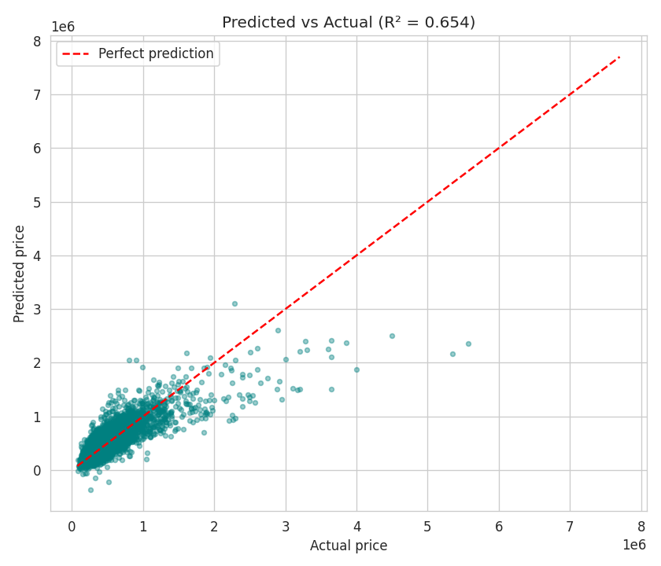

# Machine Learning & AI Internship – Week 2
**Supervised Learning (Regression & Classification)**

## Contents
| File | What it covers |
|---|---|
| `House_Price_Prediction.ipynb` | **Mini Project 2** – Linear Regression on house prices: train, predict, R², predicted-vs-actual plot |
| `Titanic_Classification.ipynb` | Assignment 2 + practice questions – Logistic Regression, confusion matrix, Decision Tree vs KNN, `max_depth` tuning |
| `data/` | Datasets (Titanic, King County house sales) |
| `images/` | Saved plots |

## Mini Project 2 – House Price Prediction
- **Model:** `LinearRegression` (scikit-learn), 80/20 train-test split, numeric features, median imputation
- **Dataset:** Kaggle *House Sales in King County* (21,613 houses, target `price`). To use Kaggle's *House Prices* (Ames) data instead, put `train.csv` in `data/` – the notebook detects it (`SalePrice`).
- **Results (test set):** R² ≈ **0.654**, RMSE ≈ 228,700, MAE ≈ 143,200



## Titanic – Classification
| Model | Accuracy |
|---|---|
| Logistic Regression | 0.799 |
| Decision Tree (default) | 0.810 |
| KNN (k=5) | 0.793 |

Tuning `max_depth` showed overfitting for unlimited depth and the best test accuracy (~0.80) at `max_depth = 3`.

## Run it
```bash
pip install -r requirements.txt
jupyter notebook
```
## Concepts used
Linear & Logistic Regression, Decision Tree, KNN, MSE / R², Confusion Matrix, train-test split, feature scaling.
